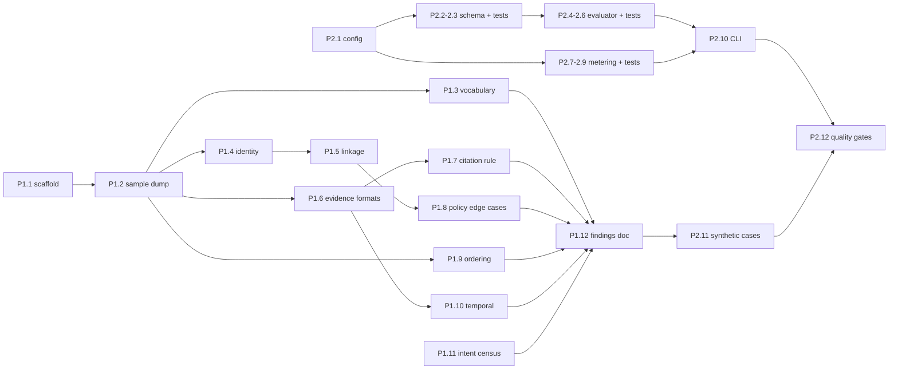

# Execution Plan — Plan.md Phase 1 & Phase 2

**Scope:** Plan.md §4 Phase 1 (Deep Inspection & Ground-Truth Alignment) and Phase 2 (Evaluation & Metering Harness, TDD).
**Prerequisite:** Phase 0 (environment, linters, mutation testing) — done.
**Runtime:** `.venv` (Python 3.15.1). All commands run from the repo root.

---

## 0. Ground Facts Verified Before Planning

These were checked against `dataset/`. Plan.md's original counts were wrong and **have since been corrected in Plan.md** (see its "Verified Evidence Inventory" table):

| Item | Plan.md originally said | Actual (now in Plan.md) |
|---|---|---|
| Evidence files (manifest rows) | 94 | **94** (`evidence_files.csv`) |
| `.sql` | 18 | **24** |
| `.json` | 20 | **28** |
| `.log` | 21 | **26** |
| `.png` | 9 | **11** |
| `.pdf` / `.txt` | 4 / 1 | 4 / 1 |
| Sample statuses | — | 10 `COMPLETE`, 22 `INCOMPLETE`, **0 `NOT_APPLICABLE`** |
| `deletion_rules.csv` | — | 15 rules (`rule_01`…`rule_15`), actions `DELETE`/`REDACT`/`ANONYMIZE`/`RETAIN` |
| `system_activity.csv` event types | — | 17 types, incl. `CLASSIFY_REQUEST` (10), `LINK_RESOURCE_IDENTITY` (12), `RESTORE_BACKUP` (1) |

> [!IMPORTANT]
> The sample set contains **no `NOT_APPLICABLE` cases**, so intent classification cannot be validated against `sample_output.csv`. Phase 1 must collect non-deletion examples from `deletion_requests.csv` text and `CLASSIFY_REQUEST` activity events, and Phase 2 must include synthetic `NOT_APPLICABLE` cases.

---

## Phase 1 — Deep Inspection & Ground-Truth Alignment

### Goal
Turn the 32 public sample cases into a **written, evidence-backed rulebook** that the deterministic engine (Phases 3–5) can implement without guessing. Every rule in Plan.md §3 is either confirmed, corrected, or flagged.

### Inputs
`dataset/sample_deletion_requests.csv`, `dataset/sample_output.csv`, `dataset/user_identities.csv`, `dataset/user_audit_log.csv`, `dataset/system_activity.csv`, `dataset/deletion_rules.csv`, `dataset/evidence_files.csv`, `dataset/evidence/**`.

### Tasks

| ID | Task | Output |
|---|---|---|
| **P1.1** | **Scaffold exploration scripts.** Create `code/scripts/` (not shipped as runtime logic) with a shared `_paths.py` that resolves `REPO_ROOT` / `DATASET_DIR` relative to the file (AGENTS.md §8). | `code/scripts/_paths.py` |
| **P1.2** | **Sample case dump.** `explore_samples.py`: join each sample request with its `sample_output.csv` row; explode `steps_json` into a flat table (`case_id, step_no, phase, system_id, resource_id, operation, state, evidence_id`). Print per-case summaries and write `code/scripts/out/sample_steps.csv`. | `sample_steps.csv` |
| **P1.3** | **Vocabulary census.** From `sample_steps.csv` count distinct `system_id`, `resource_id` prefixes (`account_`, `analytics_`, `search_`, `support_`, `data_flow_`, `backup_`, `audit_record_`…), `operation`×`state` pairs, and cited `evidence_id` values. Cross-check every operation/state pair against AGENTS.md §6.4. | Section "Vocabulary" in findings |
| **P1.4** | **Identity tracing per sample case.** For each sample: resolve the request email → `user_id` via `user_identities.csv`, then `user_audit_log.csv` (old/new values, `event_time <= audit_at`). Record which cases need historical identifiers (e.g. `case_10`) and whether email-hash matching is ever required. Verify case-insensitive exact match is sufficient (Plan.md Rule 1). | Table "Identity resolution" |
| **P1.5** | **Resource → user linkage audit.** For every `resource_id` appearing in sample outputs, find *how* it links to the user: `LINK_RESOURCE_IDENTITY` events, `system_activity.details`, or identifiers inside evidence files. Flag any resource that appears in the golden output but is **not** discoverable by the Plan.md Rule 2 heuristics. | Table "Resource linkage" |
| **P1.6** | **Evidence format inspection.** For each cited `evidence_id` in samples (at minimum `evidence_01`, `03`, `54`, `56`, `57`, `59`, `61`, `94`) open the file and document: format, record structure, how state is encoded (rows/404/null fields/`enabled`/`restore_allowed`), timestamp field, and `snapshot_scope` if present. Then do one representative of every remaining file family (SQL replica types, `resource_lookup_trace_*`, `service_events_*`, `syslog_archive_*`, `notification_delivery_*`, `search_index_diagnostic_*`, bundles, exports). | Section "Evidence formats" |
| **P1.7** | **Evidence-citation rule.** For each finding/verification step, determine *why* that specific `evidence_id` was cited when several files mention the resource: latest `captured_at <= audit_at`? most specific system? activity vs file? Write the selection rule and test it against all 32 cases by hand/script. | Rule "Citation selection" |
| **P1.8** | **Policy edge cases.** Resolve open questions in Plan.md: (a) why `case_12` `analytics_9914` is `DELETE_RECORD` instead of `ANONYMIZE_RECORD`; (b) whether already-compliant `data_flow_*`/`backup_*` appear in `COMPLETE` verification lists (`case_01`–`04`, `case_21`); (c) `ACCOUNT_TOMBSTONE` → `REDACTED` treatment; (d) `SUPPORT_MESSAGE` vs `SUPPORT_ATTACHMENT` determination; (e) `SECURITY_AUDIT_LOG` retention-window check. | Section "Policy decisions" |
| **P1.9** | **Ordering rule validation.** Apply the Plan.md Rule 6 4-key sort to every sample `steps_json` and check whether it reproduces the golden order exactly. If not, record counterexamples (e.g. downstream-before-source dependencies, AGENTS.md §6.5). | Section "Ordering" + pass/fail per case |
| **P1.10** | **Temporal rule check.** Confirm no golden step cites evidence with `captured_at > audit_at`; identify cases where a later file would flip the state (to build regression tests). Note `RESTORE_BACKUP` / `SYNC_RECORD` events that *recreate* data after deletion. | Section "Temporal" |
| **P1.11** | **Intent census (NOT_APPLICABLE).** Scan `deletion_requests.csv` `request_text` (all languages) and `CLASSIFY_REQUEST` events; bucket into deletion / access / correction / export / marketing opt-out / ambiguous / prompt-injection attempts. Pick ~15 representative texts as classifier fixtures. Do **not** label the 518 cases by hand — fixtures only. | `code/scripts/out/intent_fixtures.json` |
| **P1.12** | **Write findings doc.** Consolidate P1.3–P1.11 into `docs/findings/phase_01_ground_truth.md`, and list concrete corrections to Plan.md §3. | Findings doc |

### Deliverables
- `code/scripts/_paths.py`, `explore_samples.py`, `explore_identity.py`, `explore_evidence.py`, `explore_ordering.py`, `explore_intent.py`
- `code/scripts/out/sample_steps.csv`, `code/scripts/out/intent_fixtures.json` (gitignored if large)
- `docs/findings/phase_01_ground_truth.md`

### Acceptance Criteria
- [ ] Every one of the 32 sample cases has a documented identity chain, resource list, and per-step evidence justification.
- [ ] Every distinct evidence file family has a documented state-encoding rule.
- [ ] Citation-selection rule and ordering rule each reproduce **32/32** golden cases (or counterexamples are explicitly listed with a proposed rule).
- [ ] Open questions (a)–(e) in P1.8 are answered or explicitly marked unresolved.
- [ ] `ruff check code/` and `mypy code/` stay clean.

### Risks / Open Questions
- Sample set may not exercise every system or file family → note gaps and plan synthetic tests in Phase 2.
- PNG/PDF content is only skimmed manually here; structured extraction is Plan.md Phase 4.

---

## Phase 2 — Evaluation & Metering Harness (TDD)

### Goal
Build the scoring and token-accounting tools **before** the engine, so every later change is measured. Outputs feed `evaluation/evaluation_report.md` and `evaluation/usage_report.md` (AGENTS.md §6.8).

### Module Layout
```text
code/
├── src/
│   ├── __init__.py
│   ├── config.py                 # minimal: REPO_ROOT, DATASET_DIR, CACHE_DIR, PRICING table
│   └── evaluation/
│       ├── __init__.py
│       ├── schema.py             # step/row validation against AGENTS.md §6.3–6.4
│       ├── evaluator.py          # metrics + diff
│       └── metering.py           # LLM call accounting + usage report
├── evaluation/
│   └── main.py                   # CLI: python code/evaluation/main.py --pred <csv> --gold <csv>
└── tests/
    ├── conftest.py
    ├── fixtures/                 # tiny hand-made CSVs
    ├── test_schema.py
    ├── test_evaluator.py
    └── test_metering.py
```

### Tasks

| ID | Task | Details |
|---|---|---|
| **P2.1** | **Minimal `config.py`.** | Paths resolved from `__file__`; `load_dotenv()` optional; `PRICING: dict[str, {input_per_1m, output_per_1m}]` loaded from config with **values to be filled from the provider's official pricing page** (no invented prices); env var overrides. |
| **P2.2** | **`schema.py` — output contract validator.** | `validate_row(case_id, status, steps) -> list[str]` returning violations: allowed statuses; `NOT_APPLICABLE ⇒ []`; exactly 7 step keys; allowed phase/operation/state pairs (§6.4 table as a constant); `step_no` = 1..n; phase order FINDING→REMEDIATION→VERIFICATION; `COMPLETE ⇒` only VERIFICATION with non-empty `evidence_id`; `INCOMPLETE ⇒` non-empty `evidence_id` only on FINDING. `validate_file(path, expected_case_ids)` checks header, row count, sort order, JSON validity. |
| **P2.3** | **Tests for `schema.py` first.** | One passing fixture + one failing fixture per rule (≈15 tests). Run golden `sample_output.csv` through it — must report **zero** violations (sanity check of the validator itself). |
| **P2.4** | **`evaluator.py` — metrics.** | Normalize steps (ignore key order/whitespace, keep array order). Per case and aggregate: **case status accuracy**; **sequence accuracy** (exact ordered array equality); **step-level accuracy** reported two ways — *positional* (step i vs step i) and *set-based* (multiset match of 6-field tuples, precision/recall/F1); **field-level accuracy** for `phase`, `system_id`, `resource_id`, `operation`, `state`, `evidence_id` on positionally aligned steps; breakdown by gold status. Missing predicted case = all metrics 0 for that case. |
| **P2.5** | **`evaluator.py` — diff printer.** | `diff_case(pred, gold) -> str`: status mismatch, missing/extra steps, field mismatches, order differences. CLI flag `--show-diffs N`. |
| **P2.6** | **Tests for `evaluator.py`.** | Fixtures: identical → 100%; wrong status; one missing step; swapped order (set=100%, sequence=0%); wrong `evidence_id` only; extra case / missing case; key-order variation (must still match). |
| **P2.7** | **`metering.py` — call accounting.** | `Meter` class: `record(provider, model, purpose, input_tokens, output_tokens, cached=False)` appends to `code/cache/usage_log.jsonl`; context manager / decorator `metered_call(...)` that reads token usage from the SDK response object (Gemini `usage_metadata`, OpenAI `usage`, Anthropic `usage`); cache hits recorded with 0 tokens and `cached=True`. `summarize(run_id)` → per-model and overall: calls, input/output tokens, total & avg tokens per request, est. cost total & per request (518 denominator configurable). |
| **P2.8** | **`metering.py` — report renderer.** | `render_usage_report(summary, path="evaluation/usage_report.md")` with the exact sections required by AGENTS.md §6.8. Includes run id, timestamp, and states "deterministic-only run: 0 model calls" when applicable. Never writes keys/config values. |
| **P2.9** | **Tests for `metering.py`.** | Fake responses for each provider shape; cost math; multi-model aggregation; empty log; cached calls excluded from token totals but counted separately. |
| **P2.10** | **Evaluation CLI.** | `code/evaluation/main.py --pred output.csv --gold dataset/sample_output.csv [--cases sample] [--show-diffs 5] [--report evaluation/evaluation_report.md]`. Renders a report skeleton with metric tables, plus placeholders for "Custom evaluation cases" and "Failures found & improvements" to be filled in Phase 6. |
| **P2.11** | **Synthetic case scaffold.** | `code/tests/fixtures/synthetic/` with ≥3 hand-built cases (request + expected row): historical-email identity, tombstone with leaked phone, active data flow + restore risk, plus one `NOT_APPLICABLE` (access request) and one prompt-injection text. Gold rows only; inputs will be wired in Phase 6. |
| **P2.12** | **Quality gates.** | `ruff check code/`, `ruff format --check code/`, `mypy code/`, `pytest`; run `cosmic-ray` on `code/src/evaluation/` and record mutation score (target ≥ 80% killed). |

### Deliverables
- `code/src/config.py`, `code/src/evaluation/{schema,evaluator,metering}.py`
- `code/evaluation/main.py`
- `code/tests/test_{schema,evaluator,metering}.py`, fixtures, synthetic gold scaffold
- `evaluation/evaluation_report.md` skeleton (generated), `evaluation/usage_report.md` skeleton (generated)

### Acceptance Criteria
- [ ] `python code/evaluation/main.py --pred dataset/sample_output.csv --gold dataset/sample_output.csv` reports **100%** on every metric.
- [ ] Validator reports 0 violations on `sample_output.csv` and catches every injected violation in tests.
- [ ] `pytest` green; `ruff` + `mypy` clean; cosmic-ray mutation score recorded in PROGRESS.md.
- [ ] `usage_report.md` renders correctly from both an empty log and a synthetic multi-model log.
- [ ] No reads from outside `dataset/` for predictions; no secrets written anywhere.

### Risks / Open Questions
- Official grader's exact step/field-level formulas are unknown → report both positional and set-based variants and state definitions in the report.
- Model pricing must be sourced from provider docs at run time; keep it in config, not code.

---

## Execution Order & Dependencies



Phase 2 tasks P2.1–P2.10 do not depend on Phase 1 findings and can run in parallel with Phase 1. Only P2.11 (synthetic cases) needs P1.12.
