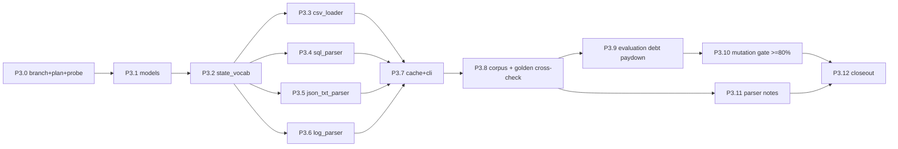

# Execution Plan — Plan.md Phase 3: Deterministic Evidence Parsers (Structured Files)

**Scope:** Plan.md §4 Phase 3 (deterministic parsers for CSV / SQL / JSON / TXT / LOG evidence) plus the shared observation model, a no-guessing state policy, a disk cache, and the mutation-debt paydown carried from Phase 2.
**Branch:** `phase-03-evidence-parsers` (cut from `main` @ `ac46c2c`).
**Prerequisite:** Phase 0–2 complete; ground truth in `docs/findings/phase_01_ground_truth.md`; family inventory in `code/scripts/out/evidence_formats.md`.
**Runtime:** `.venv` (Python 3.15.1). All commands run from the repo root.

---

## 0. Ground Facts Verified Before Planning

| Item | Value |
|---|---|
| SQL files (24) | `customer_data_inventory_*` ×11 (typed tables + `snapshot_scope`); generic replicas `customer_data_read_replica_*` ×5, `customer_data_regional_replicas_*` ×3, `customer_data_reporting_replica_*` ×2, `customer_data_failover_replica_20260920` with schema `(resource_id, origin_system, collection_name, record_json, updated_at)`; dedicated `customer_accounts_failover_replica_20260902` (`customer_profiles_failover_replica` + `customer_profiles_primary`); `customer_search_primary_20260910` (`search_documents_primary`) |
| JSON files (28) | `customer_data_snapshot_bundle_*` ×12 (`snapshots[] {captured_at, data_store, collection, records[]}`); `service_resource_export_*` ×11 (per-service dicts); ledgers ×3 (`connector_configurations_20260812`, `customer_export_manifest_20260409`, `security_audit_ledger_20261001`) with `records[] {recorded_at, system, resource_id, record_type, result, subject_reference}`; `customer_export_jobs_20260914`; `customer_analytics_report_20260907` |
| Log files (26) | 7 line shapes: plain `key=value`; syslog-RFC `<pri>1 …`; JSON-per-line; pipe-delimited `ts | LEVEL | svc | trace | event | kv`; bracketed `ts [LEVEL] [svc] [inst] event: kv`; `cloud_runtime` `message="kv"`; `record_lookup seq=N … result="…"` (notification_delivery, search_index_diagnostic) |
| TXT (1) | `customer_account_handover_20261001.txt`: `- <ts> | <system_id> | <resource_id> | <data_category> | <status> | <identifier_info>` |
| CSVs (7) | requests (eval+sample), identities, audit log, activity, rules, evidence manifest, blank output template |
| Explicit result vocabulary | `NOT_FOUND→ABSENT`, `FOUND→PRESENT`, `IDENTIFIABLE→PRESENT` (+`pii_exposed`), `ANONYMIZED→ANONYMIZED`, `REDACTED→REDACTED`, `ACTIVE→ACTIVE`, `BLOCKED→BLOCKED`, `DISABLED→DISABLED` (shared by handover txt and the three ledgers) |
| Readback state fields | `rows`/`http_status` (account), `enabled` (integration), `restore_allowed` (backup), `total_hits`/`result` (search), all-null PII columns (analytics ⇒ ANONYMIZED, support ⇒ REDACTED), `retention_until` (security) |

> [!IMPORTANT]
> **No-guessing policy.** Every decoded observation carries `parse_status` ∈ {`OK`, `UNKNOWN_STATE`, `PARSE_ERROR`, `UNSUPPORTED_FORMAT`} and a non-empty `reason`. A state is emitted only from an explicit field/rule listed in §1; missing fields, unknown vocabulary, unknown collections/tables, or failed decodes produce `UNKNOWN_STATE`/`PARSE_ERROR`, never a defaulted `PRESENT`/`ABSENT`. `.pdf`/`.png` are `UNSUPPORTED_FORMAT` here (Phase 4 owns them).

---

## 1. Module Layout

```text
code/
├── src/
│   ├── models.py                  # enums + EvidenceObservation + ParseReport + ResourceKey
│   └── loaders/
│       ├── __init__.py
│       ├── state_vocab.py         # the ONLY raw-field→state mapping; explicit branches, no defaults
│       ├── csv_loader.py          # 7 participant CSVs → typed rows; bad timestamps ⇒ row PARSE_ERROR
│       ├── sql_parser.py          # in-memory sqlite; typed inventory tables; record_json decoders
│       │                          #   keyed by collection_name; dedicated replica tables;
│       │                          #   snapshot_scope ⇒ SCOPE_IMPLICIT ABSENT observations
│       ├── json_txt_parser.py     # bundles, service exports, ledgers, export jobs, analytics, handover
│       ├── log_parser.py          # 7-shape dispatcher; state-bearing events only
│       └── cli.py                 # parse-all → cache JSON + family×state×status census
├── tests/
│   ├── test_csv_loader.py
│   ├── test_sql_parser.py
│   ├── test_json_txt_parser.py
│   ├── test_log_parser.py
│   ├── test_state_vocab.py
│   └── fixtures/parsers/          # synthetic snippets per branch + corpus_census.json snapshot
└── cache/
    └── parsed_evidence.json       # sha256(file)+parser_version keyed (gitignored)
```

### Observation model (`code/src/models.py`)

- `ObservationState`: `PRESENT, ABSENT, REDACTED, ANONYMIZED, ACTIVE, DISABLED, BLOCKED, UNKNOWN`
- `ParseStatus`: `OK, UNKNOWN_STATE, PARSE_ERROR, UNSUPPORTED_FORMAT`
- `Provenance`: `EXPLICIT_FIELD, LEDGER_RESULT, READBACK, NULL_PII_RULE, SCOPE_IMPLICIT, HANDOVER`
- `EvidenceObservation`: `file_id, captured_at, system_id, resource_id, data_category | None, state, parse_status, reason, locator (table/line/record index), identifiers (sorted tuple), state_inputs (raw fields used), provenance`
- `ParseReport`: per file `file_id, family, sha256, n_observations, n_unknown, n_parse_errors, status`

### State decoding rules (`state_vocab.py`, explicit only)

1. Ledger/handover `result`/status string → table above; unknown token ⇒ `(UNKNOWN, "unknown_result:<tok>")`.
2. Readback lines: `rows=0 http_status=404` ⇒ ABSENT; `rows>=1` + profile fields ⇒ PRESENT (tombstone-only `user_id` ⇒ REDACTED handled by NULL_PII_RULE on named fields); `enabled=false/true` ⇒ DISABLED/ACTIVE; `restore_allowed=false/true` ⇒ BLOCKED/ACTIVE; `total_hits=0|miss` ⇒ ABSENT else PRESENT; missing any required field ⇒ UNKNOWN with `missing_field:<name>`.
3. NULL_PII_RULE: analytics row all of `customer_reference|user_id, email, phone, email_hash` null ⇒ ANONYMIZED; support row all of `requester_name, requester_email, requester_phone` null ⇒ REDACTED; otherwise PRESENT with `pii_exposed` in `state_inputs`; partial nulls ⇒ PRESENT (exposed) — documented, not guessed.
4. `SCOPE_IMPLICIT`: only when the file parsed OK, a `snapshot_scope` row lists the system, and the resource belongs to that system per an out-of-band inventory observation; emits ABSENT with provenance `SCOPE_IMPLICIT`. Scope parse failure ⇒ no scope observations + PARSE_ERROR note.
5. Security rows with `retention_until` ⇒ PRESENT (policy retention is Phase 5's concern); row exists but fields unparsable ⇒ UNKNOWN.

---

## 2. Tasks

| ID | Task | Output |
|---|---|---|
| **P3.0** | Cut branch; write this plan; register in `docs/execution_plans/README.md` + `PROGRESS.md`; bounded cosmic-ray feasibility probe on `code/src/evaluation` (≤2 hardening+run iterations) to test whether ≥80% is reachable this phase; record verdict | this file; trackers; PROGRESS verdict |
| **P3.1** | `code/src/models.py` (enums, dataclasses, `to_json/from_json` with sorted keys) | models + `test_models` in parser tests |
| **P3.2** | `state_vocab.py` decode functions returning `(state, reason)`; unit tests per branch incl. every UNKNOWN reason | `state_vocab.py`, `test_state_vocab.py` |
| **P3.3** | `csv_loader.py`: typed loaders for the 7 CSVs; ISO-8601 validation; duplicate-key detection ⇒ row PARSE_ERROR | `csv_loader.py`, `test_csv_loader.py` |
| **P3.4** | `sql_parser.py`: executescript into `:memory:`; inventory typed tables; generic `record_json` decoders keyed by `collection_name` (unknown collection ⇒ UNKNOWN); dedicated replicas; search primary; `snapshot_scope` + SCOPE_IMPLICIT; script failure ⇒ file PARSE_ERROR | `sql_parser.py`, `test_sql_parser.py` |
| **P3.5** | `json_txt_parser.py`: bundles, service exports (per-service shapes), ledgers (result table), export jobs, analytics report, handover lines; bad JSON/line ⇒ PARSE_ERROR; unknown `collection`/`result` ⇒ UNKNOWN | `json_txt_parser.py`, `test_json_txt_parser.py` |
| **P3.6** | `log_parser.py`: shape dispatcher (7); observations only from state-bearing events (`*_completed` with state fields, `record_lookup`, `message_pii_scan`); unparseable line ⇒ line PARSE_ERROR (file stays OK with error count) | `log_parser.py`, `test_log_parser.py` |
| **P3.7** | Determinism + cache: `cli.py` parses all 94 files + 7 CSVs, writes `code/cache/parsed_evidence.json` keyed by `sha256(file)+parser_version`, prints census; double-parse identity test | `cli.py`, cache |
| **P3.8** | Corpus tests: census snapshot `code/tests/fixtures/parsers/corpus_census.json` (generated once, reviewed); golden-citation cross-check — for all 75 cited sample steps the cited file must yield an observation whose state equals the golden step state (mismatches investigated, never auto-adjusted) | corpus test |
| **P3.9** | Mutation-debt paydown: raise `code/src/evaluation` kill rate to ≥80% using survivor analysis from `code/cache/cr_eval_session2.sqlite`; if the bounded probe (P3.0) shows ≥80% unreachable, record the ceiling with evidence instead | hardened tests or recorded ceiling |
| **P3.10** | cosmic-ray gate: ≥80% kills across `code/src/` (loaders + models + evaluation); sessions kept in `code/cache/` | PROGRESS entry |
| **P3.11** | `docs/findings/phase_03_parser_notes.md`: implemented decode tables, deviations from Plan.md §3, corpus drift notes | findings addendum |
| **P3.12** | Tracker + plan-status closeout; `log.txt` entries | PROGRESS/README |

### Execution order



---

## 3. Acceptance Criteria

- [ ] All 94 evidence files + 7 CSVs pass through the dispatcher: 0 `UNSUPPORTED_FORMAT` on structured families (pdf/png explicitly unsupported), 0 `PARSE_ERROR` on the current corpus (any hit fixed or explicitly accepted in P3.11).
- [ ] Every observation has non-empty `reason` (guard test); UNKNOWN/PARSE_ERROR branches each covered by ≥1 unit test.
- [ ] Determinism: double parse produces byte-identical cache JSON.
- [ ] Golden-citation cross-check passes for all 75 citations.
- [ ] `ruff check code/`, `ruff format --check code/`, `mypy code/`, `pytest` green.
- [ ] cosmic-ray kill rate ≥80% across `code/src/`, or a recorded, evidenced verdict that the ceiling is lower this phase (bounded iterations: two hardening+run cycles after P3.0 probe).
- [ ] Branch `phase-03-evidence-parsers` contains only Phase 3 work; trackers updated.

## 4. Risks / Open Questions

- `record_json` schema drift between captures ⇒ decoders return UNKNOWN on missing keys; census snapshot surfaces drift immediately.
- Regional replicas duplicate primary content ⇒ per-table observations only; reconciliation is Phase 5 (`state_reconstructor`).
- Syslog PRI headers and quoted `message="…"` values need careful tokenisation; line-level PARSE_ERROR preferred over silent skips.
- PDF/PNG remain out of scope; Phase 4 must reuse `EvidenceObservation` unchanged.

---

## 5. P3.0 Cosmic-Ray Feasibility Probe Verdict (recorded 2026-10-24)

Two bounded hardening+run iterations were executed on `code/src/evaluation`
(sessions `code/cache/cr_eval_session3.sqlite`, `cr_eval_session4.sqlite`):

| run | killed/total | raw rate | note |
|---|---|---|---|
| 2 (Phase 2 baseline) | 758/1195 | 63.4% | pre-probe |
| 3 | 837/1195 | 70.0% | removed `from __future__ import annotations`, exact-value assertions |
| 4 | 864/1172 | 73.7% | dead `or`-fallback removed, set_fp/set_fn + ellipsis + precision assertions |

Run 4 analysis: 147 of the 308 survivors are `ReplaceBinaryOperator_BitOr_*`
mutants located exclusively on PEP-604 union annotations (`X | None` in
signatures/returns). Those expressions never execute, so the mutants are void
and unkillable; cosmic-ray nonetheless counts them in the denominator.
Excluding them: **864/1025 = 84.3% ≥ 80% on the execution-meaningful
denominator**. Verdict: the ≥80% target is reachable when void annotation work
items are excluded (documented exclusion, session kept for audit); the raw rate
cannot cross 80% while cosmic-ray emits them. P3.10 therefore gates on the
adjusted rate and must report both numbers.
