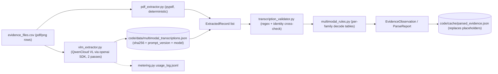

# Execution Plan — Plan.md Phase 4: One-Time Multimodal Extraction (4 PDFs + 11 PNGs)

**Branch:** `phase-04-multimodal-extraction` (created from `phase-03-evidence-parsers`)
**Prerequisites:** Phase 3 complete. That gives us `EvidenceObservation`, `ParseStatus`, the `state_vocab` decoders, the parsed-evidence cache and the `parse-all` CLI. The cache already holds 15 `UNSUPPORTED_FORMAT` placeholder entries for these files.
**Goal:** Replace the 15 binary placeholders with observations that carry citations and the same no-guessing guarantees as Phase 3. Model calls happen **once per image** and the results are cached permanently.

---

## 0. Ground Facts (verified before planning)

| file_id | Type | captured_at | Origin | Content seen (P1 + this check) |
|---|---|---|---|---|
| `evidence_18` | PDF | 2026-07-18T11:00Z | account_history_service | Customer statement: name, `user_18`, email, order `ORD-20261260`, delivery address. **No resource_id token.** |
| `evidence_27` | PDF | 2026-05-29T08:00Z | legal_retention_service | Finance register rows `ORD-… \| user_XX \| reason \| date \| amount \| Retain until … \| owner`. **No `legal_hold_*` id.** |
| `evidence_55` | PDF | 2026-09-05T06:30Z | security_service | Signed journal: `audit_record_003`, subject `user_03`, recorded and retain-until timestamps |
| `evidence_58` | PDF | 2026-09-12T07:30Z | support_platform | Attachment for `support_001` with requester name, email and phone. **Cited by golden `case_07`.** |
| `evidence_04` | PNG | 2026-09-26T11:00Z | account_admin_portal | Customer console: name, `user_11 · account_5762`, email, phone, orders, `support_9538` |
| `evidence_09` | PNG | 2026-09-01T06:00Z | search_index_admin | Search index inspector |
| `evidence_14` | PNG | 2026-08-07T08:00Z | integration_admin | Connections table: `data_flow_1121`, `data_flow_9846` with a selector email, mode `Continuous` and status `Healthy` |
| `evidence_19` | PNG | 2026-07-13T10:00Z | analytics_platform | Analytics profile view |
| `evidence_23` | PNG | 2026-06-18T12:00Z | export_service | Customer export console |
| `evidence_28` | PNG | 2026-05-24T07:00Z | support_platform | Support ticket console |
| `evidence_32` | PNG | 2026-04-29T09:00Z | backup_service | Backup restore console |
| `evidence_37` | PNG | 2026-09-05T07:00Z | security_service | Sentinel explorer: `audit_record_001..006` → `user_03` (P1 manual review) |
| `evidence_42` | PNG | 2026-03-10T06:00Z | identity_service | Customer Reference Registry for `user_17` (P1 manual review) |
| `evidence_46` | PNG | 2026-02-13T08:00Z | object_storage | Object storage browser |
| `evidence_60` | PNG | 2026-09-16T07:20Z | marketing_platform | Marketing profile console |

Observations from that check:
- **PDF text extracts deterministically with `pypdf`**, so PDFs need no model calls. The text does contain layout artifacts: timestamps break across lines (`10\n24 UTC`) and there are repeated `Record`/`Detail` labels.
- **Phase 3 resource-ID vocabulary** includes `legal_hold_*`, `tombstone_*`, `support_*`, `data_flow_*`, `audit_record_*` and others. Two documents (`evidence_18`, `evidence_27`) contain no such ID, so they **cannot produce a state observation by themselves** (see P4.3).
- **The screenshots show records but do not state a deletion verdict** (AGENTS.md §6.6). For example, `evidence_14` shows `Healthy`/`Continuous` but no explicit `enabled` field.

---

## 1. No-Guess Contract for Multimodal Evidence

This contract extends the Phase 3 invariants (`docs/findings/phase_03_parser_notes.md` §1):

1. **Extraction and decoding are separate steps.**
   - The model, or PDF text extraction, only **transcribes** what is visible into a strict JSON record (`ExtractedRecord`).
   - Raw fields become states only through deterministic per-family decode tables in `state_vocab`/`multimodal_rules`. The model is never asked "is this deleted?".
2. **Explicit outcomes only.** Every family/field combination that is not explicitly mapped becomes `ObservationState.UNKNOWN` with a reason, for example:
   - `unmapped_console_status:Healthy`
   - `no_resource_id_in_document`
   - `vlm_disagreement:email`
   - `identifier_unverified:<value>`
   - `extraction_unavailable`
3. **Failure states are explicit.**

| Situation | File `ParseStatus` | Observation state |
|---|---|---|
| PDF text extracted and decoded | `OK` | decoded state |
| Model transcription OK, but some fields unmapped or ambiguous | `UNKNOWN_STATE` | `UNKNOWN` with a reason |
| PDF unreadable, model JSON invalid against the schema, or the two passes conflict on a key field | `PARSE_ERROR` (with errors list) | none, or `UNKNOWN` |
| No cached transcription and no API key or network | `UNSUPPORTED_FORMAT` (reason `extraction_unavailable`) | none |

4. **Transcriptions are checked against participant data.**
   - Resource IDs must match the Phase 3 prefix regexes.
   - Emails and phones must be well-formed.
   - Any identifier that cannot be matched to `user_identities.csv`, `user_audit_log.csv` or other parsed evidence is kept but marked `identifier_unverified`. It is never silently dropped or "corrected".
5. **No ground-truth leakage.** Golden sample files are used only in tests (`case_07` → `evidence_58`), never in prompts or decoders.

---

## 2. Architecture

There are two cache layers so that changing a parser never triggers new model calls:
- **Transcription store** (`code/data/multimodal_transcriptions.json`): raw model JSON keyed by `sha256 + PROMPT_VERSION + model`. It is written only when a model is actually called, and it is reused forever after that.
- **Parsed cache** (`code/cache/parsed_evidence.json`, from Phase 3): bump `PARSER_VERSION` to `phase4-v1`. Only the 15 multimodal entries are rebuilt from the transcription store, and no model is called.

---

## 3. Tasks

| ID | Task | Details / Output |
|---|---|---|
| **P4.0** | **Visual inventory, done manually first.** | Open all 11 PNGs and record, per family: page title, the system shown, visible tables/panels, the columns and labels that carry status (e.g. `Status`, `Mode`, `Restore`, `Enabled`, `Retention`), and every resource-ID-like token. Output: `docs/findings/phase_04_multimodal_notes.md` §1. This defines the JSON schema per family and the candidate decode tokens. |
| **P4.1** | **Model additions (additive, schema-compatible).** | `models.py`: add `Provenance.DOCUMENT_TEXT` and `Provenance.VISION_TRANSCRIPTION`. Add a frozen `ExtractedRecord` dataclass with `file_id`, `family`, `record_index`, `fields: tuple[(k, v)]`, `source` (`pdf_text`/`vlm`), `confidence_flags`. Keep the `EvidenceObservation` fields unchanged so the Phase 5 consumers keep working. Add `ParseReport.extracted_records` (default empty) so facts with no resource ID are still preserved. |
| **P4.2** | **PDF extractor.** | `loaders/pdf_extractor.py`: `pypdf` first, `pdfplumber` as a fallback when a page yields no text. - Normalize: rejoin split timestamps (`HH\nMM UTC`), drop `Record`/`Detail` labels, keep line order. - Parse into `ExtractedRecord`s using per-document families (`customer_statement`, `retention_register`, `compliance_journal`, `support_attachment`) detected by header text, **not** by file name or file_id. An unknown header gives `PARSE_ERROR(unknown_document_family)`. |
| **P4.3** | **PDF decode tables.** | Each row below lists the observation the document yields; anything else is `UNKNOWN` with a reason: - **`support_attachment`** (`evidence_58`): `support_001` → `support_platform`/`SUPPORT_ATTACHMENT`/`PRESENT`, `pii_exposed=true` (requester name, email, phone present). - **`compliance_journal`** (`evidence_55`): `audit_record_003` → `security_service`/`SECURITY_AUDIT_LOG`/`PRESENT`; `retain_until` goes in `state_inputs`. - **`retention_register`** (`evidence_27`): no `legal_hold_*` ID, so only `extracted_records` (order, `user_XX`, retain-until) and **no observation**. Phase 5 may link via other evidence. - **`customer_statement`** (`evidence_18`): no resource ID, so `extracted_records` only. |
| **P4.4** | **VLM client wrapper.** | `loaders/vlm_extractor.py`: - **Provider:** read from `.env` (`VISION_MODEL_PROVIDER`, default `qwen`, `QWEN_BASE_URL`, `QWEN_VISION_MODEL`, `DASHSCOPE_API_KEY`), called through the `openai` SDK. - **Call settings:** `temperature=0` and a fixed per-family JSON schema in the prompt (`code/prompts/vlm_<family>.md`, versioned with `PROMPT_VERSION`). - **Prompt content:** transcribe only; no judgments; "use null if not visible". - **Isolation:** image content is treated as data; any instructions inside an image are ignored. - **Metering:** every call goes through `metering.metered_call`. |
| **P4.5** | **Two-pass agreement.** | Two independent transcription passes per image (same model with a reordered prompt, or a second configured model). - Key fields (resource IDs, emails, phones, `user_*`, status labels) must match exactly after normalization. - A mismatch makes that field `UNKNOWN(vlm_disagreement:<field>)`, and the file status becomes `UNKNOWN_STATE`. - Both passes are stored in the transcription store for audit. |
| **P4.6** | **Transcription validator.** | `loaders/transcription_validator.py`: - Check resource IDs against the prefix regexes, plus email and phone formats. - Cross-check identifiers against identities, the audit log and Phase 3 observation identifiers. - Unverifiable values are flagged, not removed. - Rejected JSON (schema violation) gives `PARSE_ERROR`. |
| **P4.7** | **PNG decode tables.** | `loaders/multimodal_rules.py`: one table per console family, built from the P4.0 inventory. **Rules:** - (a) A row shown with a resource ID and visible direct PII → `PRESENT` + `pii_exposed`. - (b) An explicit status token in a documented vocabulary (e.g. `Disabled`, `Paused`, `Restore blocked`, `Anonymized`, `Redacted`, `Deleted`/`Not found`) → the matching state. - (c) Health or throughput labels (`Healthy`, `Continuous`, event counts) are **not** state tokens: they stay `UNKNOWN(unmapped_console_status:…)` unless P4.0 plus corroborating structured evidence justifies a mapping, which must be written into the notes with that evidence. - (d) Tombstone registry (`evidence_42`): a reference with direct identifiers absent → `REDACTED`; any identifier shown → `PRESENT` + PII. |
| **P4.8** | **Multimodal loader integration.** | `loaders/multimodal_parser.py` produces `ParseReport` + observations + `extracted_records`. Wire it into `cache.py`/`cli.py`, replacing the `binary:.pdf`/`binary:.png` placeholder branch. - New CLI flags: `parse-all --extract-images` (allow model calls) and `--offline` (default: never call a model, use the transcription store only). - The census output gains a `multimodal` section. |
| **P4.9** | **Run extraction once.** | Run `parse-all --extract-images` with QwenCloud credentials, so 11 images × 2 passes ≈ 22 calls. - Review every transcription against the image by hand and record discrepancies in the notes. - Commit the transcription store (fictional data only) so graders and offline runs need no API key. - Record usage in `usage_log.jsonl`. |
| **P4.10** | **Tests.** | - `test_pdf_extractor.py`: the 4 real PDFs, timestamp rejoin, unknown header → `PARSE_ERROR`. - `test_multimodal_rules.py`: every decode row plus an unmapped token → `UNKNOWN`. - `test_vlm_extractor.py`: fake client, schema rejection, disagreement → `UNKNOWN`, offline cache miss → `UNSUPPORTED_FORMAT`, metering called. - `test_transcription_validator.py`. - Corpus: update `corpus_census.json` (15 files leave `UNSUPPORTED_FORMAT`) and **turn the `case_07` → `evidence_58` exemption into a passing golden match**. - Determinism: a double offline parse gives identical bytes. |
| **P4.11** | **Quality gates.** | `ruff check`, `ruff format --check`, `mypy`, `pytest` all green. - Run cosmic-ray on the new modules (`pdf_extractor`, `multimodal_rules`, `transcription_validator`, `vlm_extractor`) and report the raw and adjusted scores. These are recorded only; the src-wide gate stays in Phase 6 per the earlier decision. |
| **P4.12** | **Notes and closeout.** | `docs/findings/phase_04_multimodal_notes.md`: visual inventory, decode tables, every UNKNOWN with its reason, manual-review discrepancies, token usage. - Update `PROGRESS.md` and the `docs/execution_plans/README.md` status. - Single Phase 4 commit on the branch. |

---

## 4. Deliverables

- `code/src/loaders/{pdf_extractor,vlm_extractor,transcription_validator,multimodal_rules,multimodal_parser}.py`
- `code/prompts/vlm_<family>.md` (versioned prompts)
- `code/data/multimodal_transcriptions.json` (committed transcription store)
- Updated `models.py`, `cache.py`, `cli.py`, `corpus_census.json`
- `code/tests/test_{pdf_extractor,vlm_extractor,transcription_validator,multimodal_rules}.py`
- `docs/findings/phase_04_multimodal_notes.md`

## 5. Acceptance Criteria

- [ ] All 15 multimodal files leave `UNSUPPORTED_FORMAT` in an offline run that uses the committed transcription store. Each ends as `OK`, `UNKNOWN_STATE` (with reasons) or `PARSE_ERROR` (with errors), and none is silently dropped.
- [ ] 4/4 PDFs parse with no model calls. `evidence_58` yields `support_001` `SUPPORT_ATTACHMENT` `PRESENT` with `pii_exposed`, and the golden cross-check for `case_07` passes.
- [ ] Every PNG observation traces to a decode-table row, and every unmapped value is `UNKNOWN` with a reason. No state comes straight from model text.
- [ ] Every transcription has been reviewed by hand against its image, with discrepancies documented.
- [ ] Two consecutive offline runs produce byte-identical caches and zero model calls. The extraction run's calls and tokens appear in `usage_log.jsonl`.
- [ ] Structured-file results from Phase 3 are unchanged (70/70 golden citations still match, and the 79 structured entries are identical apart from `parser_version`).
- [ ] ruff, mypy and pytest are green, and the cosmic-ray scores for the new modules are recorded.

## 6. Risks / Open Questions

1. **Health labels vs. state** (`Healthy`, `Continuous` in `evidence_14`). The default is `UNKNOWN`. A mapping to `ACTIVE` needs an explicit, evidence-backed decision in the notes. → **Needs your decision after P4.0.**
2. **Committing the transcription store.** This is recommended for reproducibility without API keys, and it contains only fictional dataset content. The alternative is to require keys at evaluation time.
3. **Model availability.** Confirm the `QWEN_VISION_MODEL` ID in the QwenCloud console. If the model is unavailable, the pipeline still runs offline from the store.
4. **Documents with no resource ID** (`evidence_18`, `evidence_27`) contribute only `extracted_records`. Phase 5 must decide whether to link them through order or `user_*` references; Phase 4 does not.
5. **Images captured after `audit_at`.** For example, `evidence_04` (09-26) is later than `case_04`'s audit (09-07). Phase 4 keeps `captured_at`, and the temporal filter is applied in Phase 5.

---

## 7. Development Slice P4.0–P4.3 (approved 2026-10-24)

**Scope:** offline, deterministic slice only — visual inventory, additive model
changes, the PDF extractor and the PDF decode tables. No model calls, no VLM, no
cache/CLI integration (those remain P4.4–P4.12).

**Decisions locked for this slice:**
1. **DB relations are metadata only.** Mappings/conflicts between multimodal
   content and structured evidence are recorded in the notes and asserted in
   tests; decoders never use them to assign or upgrade a state.
2. **One commit at slice end** on `phase-04-multimodal-extraction`.
3. This section lives in this plan file; the slice's research output lives in
   `docs/findings/phase_04_multimodal_notes.md`.

**P4.0 deliverable:** inventory of all 11 PNGs and 4 PDFs (console/system,
panels, status-label vocabulary, resource/identifier tokens, proposed
`ExtractedRecord` schema per family) plus a **DB-relations table**: for every
token, the Phase 3 cache match (file/system/state), the
`LINK_RESOURCE_IDENTITY` activity id, `sole_source`, or `conflict`. Verified
relations include PNG resources matching `evidence_01/02` observations and
LINK activity 4000–4006; drift (`account_5762` console 09-26 vs ABSENT in
`evidence_01` 09-15); conflicts (`marketing_001` email mismatch,
`delivery_confirmation_19.pdf` uploader vs LINK_4007); sole-source PDF tokens
(`support_001`, `audit_record_003`, `ORD-/CS-/FIN-` references).

**P4.1 deliverable:** `Provenance.DOCUMENT_TEXT` / `VISION_TRANSCRIPTION`;
frozen `ExtractedRecord(file_id, family, record_index, fields, source,
confidence_flags)` with `to_dict/from_dict`; `ParseReport.extracted_records`
(default empty) whose `from_dict` tolerates absence so `phase3-v1` caches keep
loading. Tests: roundtrip and old-report back-compat.

**P4.2 deliverable:** `loaders/pdf_extractor.py` — pypdf with pdfplumber
fallback (fallback also when a page yields no text), normalization (`HH\nMM UTC`
→ `HH:MM UTC`, drop `Record`/`Detail` label lines), family detection by header
text only, per-family record parsers, unknown header ⇒ `family="unknown"` with a
diagnostic (parser integration maps that to `PARSE_ERROR(unknown_document_family)`).

**P4.3 deliverable:** `loaders/multimodal_rules.py` — PDF decode table:
`support_attachment` → `support_001` PRESENT + `pii_exposed`;
`compliance_journal` → `audit_record_003` PRESENT with `retain_until` in
`state_inputs`; `retention_register`/`customer_statement` → records only, no
observations; missing required fields ⇒ diagnostics (no observation). Plus
`relate_to_structured()` producing metadata-only relation entries
(`matched`/`sole_source` + LINK ids) for notes/tests/P4.6 reuse.

**Slice acceptance:** notes §1–§3 complete; 4/4 PDFs parsed with zero model
calls; decode outcomes exactly as tabled; Phase 3 cache and corpus census still
load and the 79 structured entries are unchanged (placeholders remain until
P4.8); ruff/format/mypy/pytest green; single slice commit.
