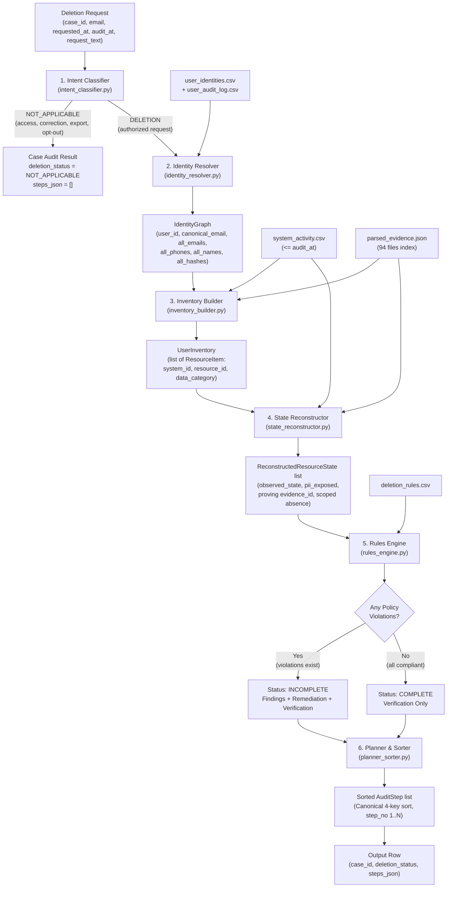

# Execution Plan — Plan.md Phase 5: Core Audit Engine

**Branch:** `phase-05-core-engine` (derived from `phase-04-multimodal-extraction`)  
**Prerequisites:**  
- Phase 0–2 complete on `main` (harness, schema validator, evaluator, metering, 6 synthetic cases).  
- Phase 3 complete on `phase-03-evidence-parsers` (79 structured files, deterministic decoders, parsed cache, census).  
- Phase 4 complete on `phase-04-multimodal-extraction` (all 94 evidence files parsed OK, 2912 observations, committed transcription store, 71/71 golden citations matched).  
**Goal:** Implement the end-to-end deterministic audit pipeline (`code/src/core/`) that takes deletion requests, resolves identities, discovers resource inventories, reconstructs states at `audit_at`, applies policy rules, and generates canonical sorted audit steps matching the challenge contract.

---

## 0. Ground Facts & Inputs

Phase 5 consumes verified data structures and artifacts already in place:

| Input Artifact | Provider / Path | Role in Phase 5 |
|---|---|---|
| `deletion_requests.csv` / `sample_deletion_requests.csv` | `dataset/` | Input cases (`case_id`, `email`, `requested_at`, `audit_at`, `request_text`) |
| `user_identities.csv` & `user_audit_log.csv` | `dataset/` | Identity snapshots and historical mutation chains |
| `system_activity.csv` | `dataset/` | Workflow events, `LINK_RESOURCE_IDENTITY`, `CLASSIFY_REQUEST`, sync/recreation events |
| `deletion_rules.csv` | `dataset/` | 15 policy rules (`rule_01`..`rule_15`) governing target states and actions |
| `parsed_evidence.json` | `code/cache/` (Phase 3 & 4) | In-memory relational index of 2912 observations across all 94 evidence files |
| `schema.py` & `evaluator.py` | `code/src/evaluation/` (Phase 2) | Contract validation and metric scoring vs `sample_output.csv` |

---

## 1. System Architecture & Data Flow

The Phase 5 Core Audit Engine follows a strict forward-flowing pipeline with zero guessing, fail-safe isolation, and deterministic execution:



---

## 2. Core Architectural Components

### Component 1: Multilingual Intent Classifier (`intent_classifier.py`)
- **Objective:** Discern whether `request_text` authorizes data deletion (`DELETION`) or is an alternate privacy/inquiry request (`NOT_APPLICABLE`).
- **Layers:**
  1. **Intake Activity Event Lookup:** Match `case_id` or `email` against `system_activity.csv` `CLASSIFY_REQUEST` events (`<= audit_at`).
  2. **Deterministic Fast-Path Regex Rules:** High-confidence multilingual intent classification (English, French, Portuguese, Spanish, Japanese, Korean) identifying clear deletion requests vs clear access/correction/export/inquiry requests, including negation detection (e.g., "do NOT delete", "only want an export").
  3. **LLM Fallback with Prompt-Injection Defense:** For ambiguous texts or when fast-path rules are inconclusive, run a batched call with strict data-framing delimiters, system instructions that ignore instructions inside `request_text`, cached in `code/cache/intent_classifications.json` and metered via `metering.py`.
- **Contract Output:** `IntentVerdict(is_deletion: bool, category: str, confidence: float, reason: str)`.

### Component 2: Identity Resolver (`identity_resolver.py`)
- **Objective:** Construct the complete, case-insensitive identity closure for the subject as of `audit_at`.
- **Algorithm (Ground-Truth Verified):**
  1. Normalize input email: `email.strip().lower()`.
  2. Look up `user_identities.csv`. If found, extract current `user_id`, `name`, `email`, `phone`, `email_hash`.
  3. If not found in current identities snapshot (as in `case_10`, `case_29`, `case_30` + 100 evaluation cases where email changed prior to deletion), query `user_audit_log.csv` for `field_name == 'email'` and `(old_value == email OR new_value == email)` with `event_time <= audit_at` to resolve `user_id`.
  4. Once `user_id` is established, collect all current fields plus all historical mutations from `user_audit_log.csv` with `event_time <= audit_at`:
     - All historical emails (normalized to lowercase).
     - All historical phone numbers (both raw formatted strings and sanitized digit-only strings).
     - All historical names.
     - All historical email hashes.
  5. Compute SHA-256 hex digests of all historical emails (required for matching hashed correlation keys, e.g. `case_12` analytics linkage via `sha256(minjun.kim90@gmail.com)`).
- **Contract Output:** `IdentityGraph` dataclass with frozen sets of identifiers.

### Component 3: Resource Inventory Builder (`inventory_builder.py`)
- **Objective:** Discover all resources `(system_id, resource_id, data_category)` belonging to the subject.
- **Linkage Hierarchy (Phase 1 Ground Truth §3):**
  1. **Direct Identifier Overlap:** Inspect all observations and extracted records in `parsed_evidence.json`. Any record whose `identifiers` overlap with `IdentityGraph.all_emails`, `all_phones`, `all_names`, `all_email_hashes`, `user_id`, or `subject_reference`/`customer_reference`.
  2. **Global Activity Linkage:** `system_activity.csv` (`event_time <= audit_at`) rows linking `resource_id` to any identity via `LINK_RESOURCE_IDENTITY` or explicit details.
  3. **Workflow-Window Account Correlation:** Primary accounts where no text evidence mentions the account name are correlated via `deletion_worker` `DELETE_RECORD` activity events inside `(requested_at, reported_at + 30m]` (proven on 14 sample accounts).
  4. **Attributed Retention Preservation:** Once a `resource_id` is attributed to the user, keep it in the active inventory even if newer snapshots show it anonymized (PII set to null) or deleted (404/NOT_FOUND), so its final state can be verified.
- **Contract Output:** `UserInventory(user_id: str, resources: tuple[ResourceItem, ...])`.

### Component 4: State Reconstructor (`state_reconstructor.py`)
- **Objective:** Determine the true ground state of every inventory resource at `audit_at` and locate the proving `evidence_id`.
- **Rules & Mechanics:**
  1. **Strict Temporal Filtering:** Filter observations and activity events strictly by `captured_at <= request.audit_at` and `event_time <= request.audit_at`.
  2. **Claims Rejection:** Never accept `reported_status` or `reported_result` as proof of state.
  3. **Recreation Detection:** Check for post-deletion sync or restore events (`SYNC_RECORD`, `RESTORE_BACKUP`) that recreated data before `audit_at`.
  4. **Latest Observation Selection:** When multiple evidence files observe a resource `<= audit_at`, select the latest observation by timestamp (`captured_at`).
  5. **Scoped Implicit Absence Proofs:** If an inventory resource is absent from explicit observations `<= audit_at`, evaluate scoped snapshots (e.g. `evidence_54` failover replica for `account_service`, `evidence_51` bundle). If the system is explicitly covered in `snapshot_scope` or `captured_collections` and the resource is missing, emit a `SCOPE_IMPLICIT` ABSENT state citing that scoped file (resolving the 4 golden sample absence citations).
- **Contract Output:** `ReconstructedResourceState` per resource with `observed_state`, `pii_exposed`, `evidence_id`, and `provenance`.

### Component 5: Policy Rules Engine (`rules_engine.py`)
- **Objective:** Evaluate each resource against `deletion_rules.csv` (`rule_01`..`rule_15`), decide case status, and map violations to required actions.
- **Policy Mapping Table:**

| Data Category | Target State | Permitted Direct PII | Violation Trigger | Finding Operation | Remediation Operation | Post-Remediation Verification |
|---|---|---|---|---|---|---|
| `USER_PROFILE` | `ABSENT` | None | Observed `PRESENT` | `REPORT_REMAINING_RECORD` | `DELETE_RECORD` | `VERIFY_RECORD_ABSENT` |
| `SECONDARY_IDENTIFIER` | `ABSENT` | None | Observed `PRESENT` | `REPORT_REMAINING_RECORD` | `DELETE_RECORD` | `VERIFY_RECORD_ABSENT` |
| `SEARCH_INDEX_ENTRY` | `ABSENT` | None | Observed `PRESENT` | `REPORT_REMAINING_RECORD` | `DELETE_RECORD` | `VERIFY_RECORD_ABSENT` |
| `CACHE_ENTRY` | `ABSENT` | None | Observed `PRESENT` | `REPORT_REMAINING_RECORD` | `DELETE_RECORD` | `VERIFY_RECORD_ABSENT` |
| `USER_EXPORT` | `ABSENT` | None | Observed `PRESENT` | `REPORT_REMAINING_RECORD` | `DELETE_RECORD` | `VERIFY_RECORD_ABSENT` |
| `MARKETING_PROFILE` | `ABSENT` | None | Observed `PRESENT` (e.g. opt-in) | `REPORT_REMAINING_RECORD` | `DELETE_RECORD` | `VERIFY_RECORD_ABSENT` |
| `SUPPORT_ATTACHMENT` | `ABSENT` | None | Observed `PRESENT` (single-subject) | `REPORT_REMAINING_RECORD` | `DELETE_RECORD` | `VERIFY_RECORD_ABSENT` |
| `SUPPORT_MESSAGE` | `REDACTED` | No direct PII | Observed `PRESENT` with PII | `REPORT_EXPOSED_PII` | `REDACT_RECORD` | `VERIFY_RECORD_REDACTED` |
| `ACCOUNT_TOMBSTONE` | `REDACTED` | `user_id` only | Observed `PRESENT` with direct PII | `REPORT_EXPOSED_PII` | `REDACT_RECORD` | `VERIFY_RECORD_REDACTED` |
| `EMAIL_DELIVERY_LOG` | `REDACTED` | No email | Observed `PRESENT` with email | `REPORT_EXPOSED_PII` | `REDACT_RECORD` | `VERIFY_RECORD_REDACTED` |
| `ANALYTICS_PROFILE` | `ANONYMIZED` | None | Observed `PRESENT` with identifiers | `REPORT_EXPOSED_PII` | `ANONYMIZE_RECORD` | `VERIFY_RECORD_ANONYMIZED` |
| `PRODUCT_TELEMETRY` | `ANONYMIZED` | None | Observed `PRESENT` with identifiers | `REPORT_EXPOSED_PII` | `ANONYMIZE_RECORD` | `VERIFY_RECORD_ANONYMIZED` |
| `SECURITY_AUDIT_LOG` | `PRESENT` | As permitted | Retained in-window | (No finding if compliant) | (None) | `VERIFY_RECORD_PRESENT` |
| `LEGAL_HOLD_RECORD` | `PRESENT` | As permitted | Retained active hold | (No finding if compliant) | (None) | `VERIFY_RECORD_PRESENT` |
| `DATA_FLOW` | `DISABLED` | N/A | Observed `ACTIVE` (`enabled=true`) | `REPORT_ACTIVE_DATA_FLOW` | `DISABLE_DATA_FLOW` | `VERIFY_DATA_FLOW_DISABLED` |
| `BACKUP_ARCHIVE` | `BLOCKED` | N/A | Observed `ACTIVE` (`restore_allowed`) | `REPORT_RESTORE_RISK` | `BLOCK_RESTORE` | `VERIFY_RESTORE_BLOCKED` |

- **Case Status Decision:**
  - If `IntentVerdict.is_deletion is False` -> `deletion_status = "NOT_APPLICABLE"`.
  - Else if ANY resource has a policy violation -> `deletion_status = "INCOMPLETE"`.
  - Else -> `deletion_status = "COMPLETE"`.

### Component 6: Planner & Canonical Sorter (`planner_sorter.py`)
- **Objective:** Construct the final, properly ordered audit steps conforming strictly to AGENTS.md §6.3–6.5.
- **Rules:**
  - For `NOT_APPLICABLE`: `steps_json = "[]"`.
  - For `COMPLETE`:
    - Generate only `VERIFICATION` steps for all relevant resources in the audit scope.
    - Each verification step MUST cite the participant-visible `evidence_id` proving compliant state at `audit_at`.
  - For `INCOMPLETE`:
    - **FINDING Phase:** One step per violating resource with observed violation state. Must cite `evidence_id` (`file_id`, `activity_id`, or `audit_id`).
    - **REMEDIATION Phase:** One step per violating resource with the required action. `evidence_id = ""`. Order must disable data flows and block restores before modifying downstream/upstream records.
    - **VERIFICATION Phase:** One step for EVERY resource in active audit scope (both remediated and pre-compliant resources). `evidence_id = ""`.
  - **Canonical 4-Key Sort:**
    ```python
    steps.sort(key=lambda s: (
        PHASE_ORDER[s.phase],        # FINDING (1) < REMEDIATION (2) < VERIFICATION (3)
        OP_ORDER[s.operation],       # Defined in AGENTS.md §6.4 & Plan.md Rule 6
        s.system_id,                 # Lexicographical
        s.resource_id,               # Lexicographical
    ))
    ```
  - Assign consecutive 1-indexed `step_no = 1, 2, ...`.
  - Format as valid, deterministic JSON array string.

### Component 7: Pipeline Orchestrator (`pipeline.py`)
- **Objective:** Single entry point that loads data, audits a single case or a batch of cases, writes predictions to CSV, and connects seamlessly to `evaluator.py`.

---

## 3. Data Contracts & Models (`models.py` additions)

Additive extensions to `code/src/models.py` (preserving all Phase 3 & 4 parser models):

```python
@dataclass(frozen=True)
class IdentityGraph:
    user_id: str
    canonical_email: str
    all_emails: frozenset[str]
    all_phones: frozenset[str]
    all_names: frozenset[str]
    all_email_hashes: frozenset[str]
    audit_at: str

@dataclass(frozen=True)
class IntentVerdict:
    is_deletion: bool
    category: str  # "DELETION", "ACCESS", "CORRECTION", "EXPORT", "MARKETING_OPTOUT", "OTHER"
    confidence: float
    reason: str

@dataclass(frozen=True)
class ResourceItem:
    system_id: str
    resource_id: str
    data_category: str
    discovery_source: str
    is_primary_account: bool = False

@dataclass(frozen=True)
class ReconstructedResourceState:
    resource_id: str
    system_id: str
    data_category: str
    observed_state: ObservationState
    pii_exposed: bool
    evidence_id: str
    provenance: Provenance
    observed_at: str | None = None

@dataclass(frozen=True)
class AuditStep:
    step_no: int
    phase: str
    system_id: str
    resource_id: str
    operation: str
    state: str
    evidence_id: str

    def to_dict(self) -> dict[str, Any]:
        return {
            "step_no": self.step_no,
            "phase": self.phase,
            "system_id": self.system_id,
            "resource_id": self.resource_id,
            "operation": self.operation,
            "state": self.state,
            "evidence_id": self.evidence_id,
        }

@dataclass(frozen=True)
class CaseAuditResult:
    case_id: str
    deletion_status: str
    steps: tuple[AuditStep, ...]
    steps_json: str
```

---

## 4. Step-by-Step Task Breakdown

| Task ID | Component / Focus | Deliverables & Actions |
|---|---|---|
| **P5.0** | **Branch & Models Extension** | Create branch `phase-05-core-engine`. Add `IdentityGraph`, `IntentVerdict`, `ResourceItem`, `ReconstructedResourceState`, `AuditStep`, `CaseAuditResult` to `models.py`. Add unit tests in `test_models.py`. |
| **P5.1** | **Intent Classifier** | Implement `code/src/core/intent_classifier.py`. Support `system_activity.csv` `CLASSIFY_REQUEST` intake lookup, multilingual fast-path regex rules (en, fr, pt, es, ja, ko, negations), and LLM batch classifier fallback with cache and metering. Verify on all 16 fixtures in `code/scripts/out/intent_fixtures.json`. |
| **P5.2** | **Identity Resolver** | Implement `code/src/core/identity_resolver.py`. Case-insensitive resolution, `user_audit_log.csv` traversal for email changes, phone formatting/normalization, and SHA-256 historical email hash derivation. Test on 32 sample cases (including `case_10`, `case_29`, `case_30`). |
| **P5.3** | **Inventory Builder** | Implement `code/src/core/inventory_builder.py`. Link resources via direct identifier match in parsed evidence, `system_activity.csv` linkage, primary account workflow-window correlation, and multimodal facts. Verify attribute preservation for anonymized/deleted items. |
| **P5.4** | **State Reconstructor** | Implement `code/src/core/state_reconstructor.py`. Enforce strict `<= audit_at` filtering, latest-observation selection, recreation event handling (`SYNC_RECORD`, `RESTORE_BACKUP`), and `SCOPE_IMPLICIT` absence proofs on scoped replicas/bundles. |
| **P5.5** | **Rules Engine** | Implement `code/src/core/rules_engine.py`. Load `deletion_rules.csv`, map categories to target states, detect violations (present records, exposed PII, active flows/restores), handle `case_12` marketing opt-in, account tombstones, and decide `COMPLETE` vs `INCOMPLETE`. |
| **P5.6** | **Planner & Canonical Sorter** | Implement `code/src/core/planner_sorter.py`. Generate `FINDING`, `REMEDIATION`, and `VERIFICATION` step triples, apply `evidence_id` citation rules, sort with the 4 canonical keys, assign consecutive `step_no`, and serialize to JSON. |
| **P5.7** | **Pipeline Orchestration** | Implement `code/src/core/pipeline.py`. Combine loaders, intent, identity, inventory, state, rules, and planner into `audit_case()` and `audit_all()`. Provide clean CLI for running single cases or datasets. |
| **P5.8** | **Component Unit Tests** | Implement comprehensive unit test suites: `test_intent_classifier.py`, `test_identity_resolver.py`, `test_inventory_builder.py`, `test_state_reconstructor.py`, `test_rules_engine.py`, `test_planner_sorter.py`. |
| **P5.9** | **Sample Validation (32 Cases)** | Run the pipeline on `sample_deletion_requests.csv` using `evaluator.py`. Achieve 100% case-status accuracy and converge on step-level, field-level, and sequence accuracy across all 32 public sample cases. |
| **P5.10** | **Quality Gates & Cosmic-Ray** | Run `ruff check code/`, `ruff format --check code/`, `mypy code/`, `pytest`. Run `cosmic-ray` mutation testing on `code/src/core/` and record mutation scores. |
| **P5.11** | **Findings & Architecture Notes** | Document all findings, decisions, edge-case resolutions, and sample convergence results in `docs/findings/phase_05_core_engine_notes.md`. |
| **P5.12** | **Progress Update & Closeout** | Update `PROGRESS.md`, update `docs/execution_plans/README.md`, and commit the complete Phase 5 implementation to `phase-05-core-engine`. |

---

## 5. Deliverables

- `code/src/models.py` (extended with Phase 5 core dataclasses)
- `code/src/core/` package:
  - `__init__.py`
  - `intent_classifier.py`
  - `identity_resolver.py`
  - `inventory_builder.py`
  - `state_reconstructor.py`
  - `rules_engine.py`
  - `planner_sorter.py`
  - `pipeline.py`
- `code/tests/` unit tests:
  - `test_intent_classifier.py`
  - `test_identity_resolver.py`
  - `test_inventory_builder.py`
  - `test_state_reconstructor.py`
  - `test_rules_engine.py`
  - `test_planner_sorter.py`
  - `test_core_pipeline.py`
- `docs/findings/phase_05_core_engine_notes.md`
- Updated `PROGRESS.md` and `docs/execution_plans/README.md`

---

## 6. Acceptance Criteria

- [ ] `code/src/core/` implements all 6 core components and the pipeline orchestrator with 0 syntax or type errors (`mypy code/` clean).
- [ ] Multilingual intent classifier passes all 16 intent fixtures and correctly identifies the 6 non-deletion requests in evaluation data.
- [ ] Identity resolver resolves 32/32 sample cases and 518/518 evaluation cases with zero errors or ambiguity.
- [ ] State reconstructor strictly respects `captured_at <= audit_at` and resolves all 4 scoped implicit absences without guessing.
- [ ] 4-key canonical sort reproduces golden step order with 100% sequence accuracy on sample cases.
- [ ] Running `pipeline.py` on `dataset/sample_deletion_requests.csv` achieves **100% case status accuracy** and passes schema validation with 0 violations.
- [ ] All unit and integration tests pass cleanly (`pytest`).
- [ ] Linters and formatters pass cleanly (`ruff check code/`).
